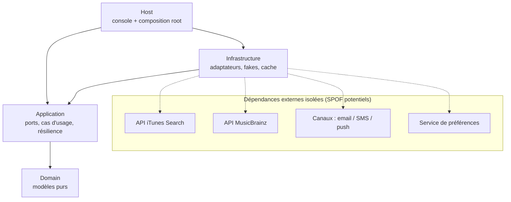
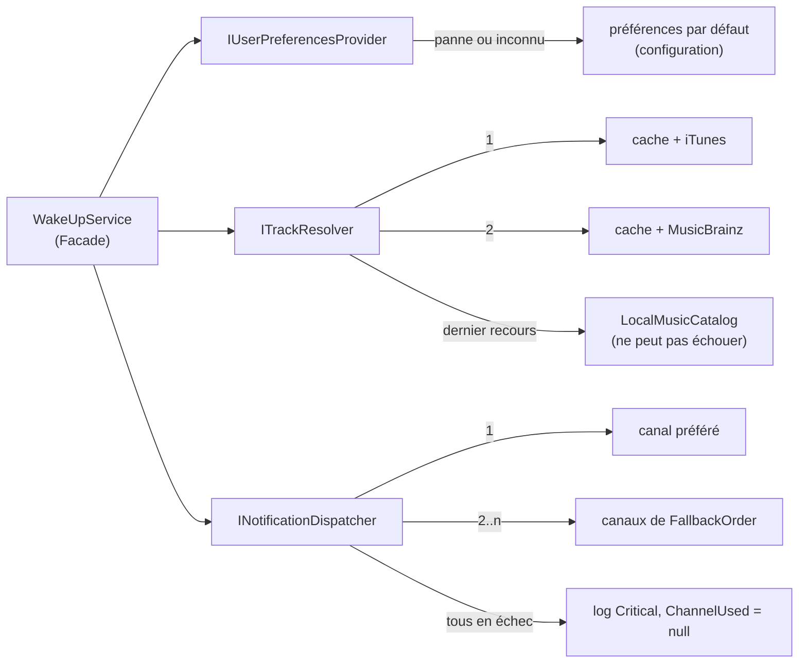

# Architecture — Réveil musical

## 1. Du besoin métier à la décision

| Besoin métier | Décision | Notion du cours |
|---|---|---|
| Changer de source musicale rapidement (trop chère, limitée, en panne) | Port `IMusicCatalog` ; un adaptateur par fournisseur (iTunes, MusicBrainz, local) ; ordre choisi dans `appsettings.json` ou par variable d'environnement, sans recompiler | Boundary, Adapter, Strategy, anti lock-in |
| Canaux email / SMS / push aujourd'hui, WhatsApp et appel vocal demain | Port `INotificationChannel` ; chaque mock a sa propre interface, ramenée au port par un adaptateur ; identifiant de canal = chaîne (`ChannelId`), pas un enum : ajouter un canal ne modifie aucun code existant | Adapter, couplage faible, ouvert/fermé |
| Aucun composant sans vérification de licence et de fraîcheur | Dépendances minimales (`Microsoft.Extensions.*`, xUnit) ; licence lue dans le `.nuspec` avant ajout ; tableau directes + transitives dans le README | Dépendances transitives, licences, versionning |
| Une panne ne doit jamais empêcher l'envoi | Chaîne de fournisseurs avec repli local (`ResilientTrackResolver`) ; repli de canal (`FallbackNotificationDispatcher`) ; préférences par défaut (`DefaultingUserPreferencesProvider`) ; cache des succès | SPOF, mode dégradé, failover, cache |
| Aucune classe métier ne connaît un détail technique | Architecture en couches ; DTO fournisseurs `internal` à l'adaptateur ; tests d'architecture par réflexion | Architecture en couches, isolation, fuite de DTO |
| Aucun `new` d'implémentation concrète | Injection par constructeur partout ; composition root unique dans le Host ; keyed services | IoC, DI, conteneur, Factory via DI |
| Code testable sans réseau | Fakes écrits à la main, `StubHttpMessageHandler`, tests de contrat partagés par abstraction | Seam, fakes, tests de contrat |

## 2. Couches et dépendances

Les dépendances pointent vers l'intérieur : l'infrastructure implémente les ports définis par l'application. Le domaine ne référence rien.

Chaque dépendance externe est isolée derrière un port et dispose d'un mode dégradé :

| SPOF | Isolation | Mode dégradé |
|---|---|---|
| Fournisseur musical | `IMusicCatalog` | fournisseur suivant, puis liste locale (`Degraded = true`) |
| Canal de notification | `INotificationChannel` | canaux de `FallbackOrder`, un par un |
| Service de préférences | `IUserPreferencesProvider` | préférences par défaut issues de la configuration |

## 3. Patterns utilisés

| Pattern | Où | Problème résolu |
|---|---|---|
| Adapter | `ITunesMusicCatalog`, `MusicBrainzMusicCatalog`, `EmailChannel`, `SmsChannel`, `PushChannel` | l'interface externe ne convient pas au domaine ; ses champs (`trackViewUrl`…) ne sortent pas de l'adaptateur |
| Facade | `WakeUpService` | orchestre préférences, sélection, résolution, message et envoi derrière une seule méthode |
| Strategy | `IMusicCatalog` (chaîne ordonnée par la config), `INotificationChannel` (choisi au runtime) | plusieurs comportements interchangeables sans toucher l'appelant |
| Décorateur | `CachedMusicCatalog`, `DefaultingUserPreferencesProvider` | ajoute cache ou repli sans modifier le composant décoré |
| Factory via DI | enregistrements à fabrique, keyed services, `ActivatorUtilities` | création complexe centralisée dans la composition root, aucun `new` éparpillé |

Le cache décore **chaque fournisseur réseau**, pas la chaîne : sinon un repli local serait mis en cache pendant une panne. Seuls les succès sont mis en cache (ni `null`, ni échec).

## 4. Durées de vie

| Composant | Durée de vie | Raison |
|---|---|---|
| `InMemoryCache` | Singleton | état partagé pour toute l'application ; instance injectée, aucun `static` |
| `TimeProvider` (horloge du cache) | Singleton | horloge injectée plutôt que lue dans le contexte d'exécution ; remplacée par une horloge pilotée en test |
| `NotificationPolicy`, `WakeUpDefaults` | Singleton | valeurs immuables lues une fois dans la configuration |
| Adaptateurs, décorateurs, dispatcher, resolver, `WakeUpService` | Transient | services légers et sans état |
| `HttpClient` | géré par `IHttpClientFactory` | réutilisation des connexions |

Aucun Singleton ne reçoit de service Scoped : pas de dépendance captive.

La composition root est `CompositionRoot.AddReveilMusical` (projet Host). Les fournisseurs musicaux sont des keyed services (`itunes`, `musicbrainz`, `local`) ; la chaîne est assemblée depuis `Music:Providers`, et un nom inconnu arrête l'application au démarrage en listant les noms valides. Le service de préférences brut est enregistré sous la clé `source`, puis décoré.

## 5. Contrats de résilience

- `IMusicCatalog.FindAsync` peut renvoyer `null` ou lever : un fournisseur « comme un autre ».
- `ITrackResolver.ResolveAsync` garantit un `Track` : jamais `null`, jamais d'exception.
- `INotificationChannel.SendAsync` lève en cas d'échec.
- `INotificationDispatcher.DispatchAsync` ne lève jamais ; `null` signifie que tous les canaux ont échoué.
- `IWakeUpService.SendWakeUpAsync` ne lève jamais pour une panne externe ; seule l'annulation (`OperationCanceledException`) est propagée.

## 6. Dépendances cachées bannies

- Pas de `DateTime.Now` : le jour arrive en entrée.
- Pas de `static` mutable.
- Pas de lecture d'environnement hors du binding de configuration.
- Pas de `CultureInfo` implicite : noms de jours et de météos dans des dictionnaires explicites.

## 7. Hypothèses

- Le jour de la semaine sert à composer le message ; le morceau dépend de la météo (préférences utilisateur).
- L'annuaire de contacts est hors périmètre : le destinataire est dérivé de `userId`.
- L'ordonnancement (heure d'envoi) n'est pas à coder.
- Pas de circuit breaker dans cette version : piste d'évolution.
